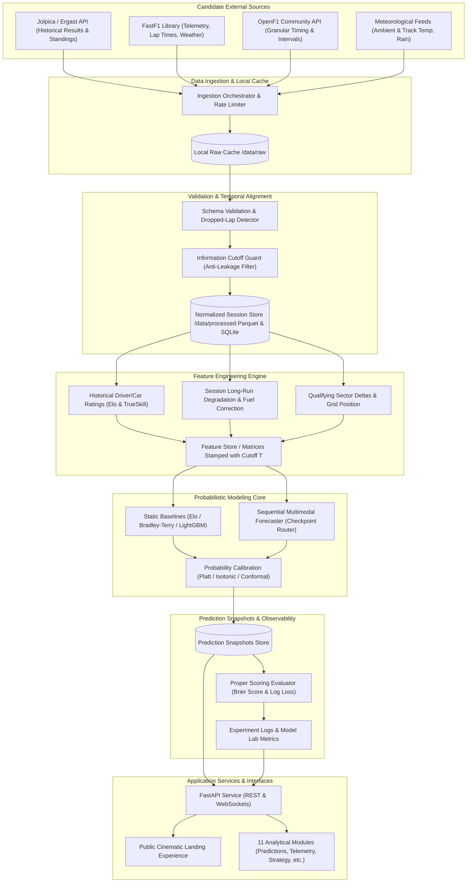
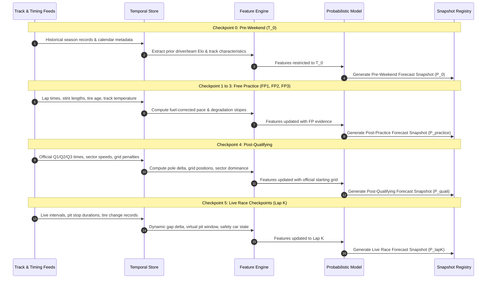

# APEX — F1 Intelligence: System Map & Pipeline Flow

> **Status:** ARCHITECTURAL SPECIFICATION — Represents the end-to-end operational pipeline planned for APEX. Solid nodes indicate core pipeline components; dashed subgraphs designate candidate external feeds and prospective live integration.

---

## 1. End-to-End System Pipeline

---

## 2. Checkpoint-Driven Information Flow

The pipeline enforces sequential progression across Grand Prix weekend checkpoints. At each cutoff point $T$, features are locked and a new prediction snapshot is produced:

---

## 3. Implementation Status of Diagram Components

| Component | Architecture Role | Current Status in M0 | Next Action |
|---|---|---|---|
| Ingestion Orchestrator | Connects to external APIs | Provisional Design | Audit in Milestone 1 ([DATA_AVAILABILITY_AUDIT.md](research/DATA_AVAILABILITY_AUDIT.md)) |
| Normalized Session Store | Parquet/SQLite storage | Provisional Schema | Implement in Milestone 2 |
| Information Cutoff Guard | Prevents temporal leakage | Specification defined | Build unit tests in Milestone 2 |
| Feature Engine | Checkpoint matrix generator | Mathematical model planned | Milestone 4 |
| Baseline Models | Elo, Bradley-Terry, GBDT | Formulated in methodology | Milestone 3 |
| Calibration Core | Isotonic / Conformal scaling | Evaluation protocol drafted | Milestone 3 |
| API Gateway | FastAPI endpoints | Empty skeleton | Milestone 6 |
| Frontend Workspace | Next.js visual suite | Empty skeleton | Milestone 7 |
