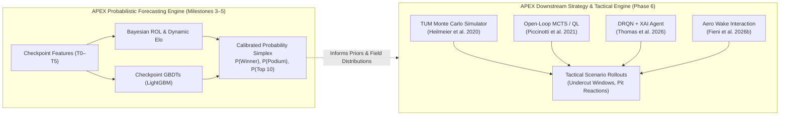

# APEX — Research Methodology

> **Status:** PROPOSED CANDIDATE METHODOLOGY — Formulates the candidate sequential modeling approach. Subject to empirical verification and baseline benchmarking in Milestones 3 and 4.

---

## 1. Problem Formulation & Prediction Targets

Let $E$ denote a Grand Prix event featuring $N$ competing drivers ($N \approx 20$) and $M$ constructors ($M \approx 10$). At any forecast checkpoint $T \in \{T_0, T_1, \dots, T_K\}$, the platform ingests an information set $\mathcal{I}_T$ strictly satisfying:
$$\mathcal{I}_T = \{ \text{Data records with event timestamp } t \le T \}$$

The modeling engine outputs calibrated probability distributions over four formal targets:

1. **Race Winner ($Y_{\text{win}}$):** Categorical distribution $\mathbf{p} = [p_1, p_2, \dots, p_N]$ such that:
   $$\sum_{i=1}^N p_i = 1, \quad p_i = P(\text{Driver } i \text{ finishes P1} \mid \mathcal{I}_T)$$
2. **Podium Finish ($Y_{\text{podium}, i}$):** Marginal binary probability that driver $i$ finishes in the top 3:
   $$q_i = P(\text{Finishing Rank}_i \le 3 \mid \mathcal{I}_T), \quad \text{with constraint } \sum_{i=1}^N q_i = 3$$
3. **Points Finish ($Y_{\text{top10}, i}$):** Marginal probability that driver $i$ finishes $\le 10$:
   $$r_i = P(\text{Finishing Rank}_i \le 10 \mid \mathcal{I}_T), \quad \sum_{i=1}^N r_i = 10$$
4. **Classified Retirement / DNF ($Y_{\text{dnf}, i}$):** Marginal probability that driver $i$ fails to finish the Grand Prix due to mechanical failure or collision.

---

## 2. Discrete Weekend Forecast Checkpoints

The weekend is segmented into six standard sequential checkpoints:

| Checkpoint ID | Name | Information Cutoff ($T_{cutoff}$) | Primary Features Introduced | Verified Data Source & Era |
|---|---|---|---|---|
| **$T_0$** | **Pre-Weekend** | Wednesday 23:59 UTC prior to event | Rolling Elo ratings, constructor championship standings, circuit historical attributes (safety car frequency, overtaking difficulty). | Jolpica F1 API (1950–2026) |
| **$T_1$** | **Post-FP1** | End of Free Practice 1 | Initial single-lap pace deltas, installation run telemetry, ambient track conditions. | OpenF1 API (2023–2026) |
| **$T_2$** | **Post-FP2** | End of Free Practice 2 | Representative high-fuel long-run pace, stint tire degradation slopes, compound life estimates. | OpenF1 API (2023–2026) |
| **$T_3$** | **Post-FP3** | End of Free Practice 3 | Qualifying simulation lap times, low-fuel corner minimum speeds, final engine mode calibrations. | OpenF1 API (2023–2026) |
| **$T_4$** | **Post-Qualifying** | 1 hour post-Q3 session conclusion | Official qualifying order, pole delta ($\Delta_{\text{pole}}$), sector dominance markers, confirmed grid penalties. | Jolpica F1 (1950–2026) & OpenF1 (2023–2026) |
| **$T_5$** | **Pre-Race** | 30 minutes prior to formation lap | Final starting grid, declared starting tire compound, formation lap track temperature, weather radar probability. | OpenF1 API (2023–2026) |
| **$T_{6, K}$** | **Live Lap $K$** | Lap $K$ line crossing | Live track intervals, pit stops completed, tire age, active track status (Green/VSC/SC). | OpenF1 API (2023–2026) |

### 2.1 Pre-Race Candidate Field Reconstruction Protocol ($T_5$)

Constructing the candidate pool at $T_5$ requires strict adherence to empirical protocols established in [docs/research/CANDIDATE_FIELD_AUDIT.md](CANDIDATE_FIELD_AUDIT.md):

1. **Provisional Result-Record Proxy Caveat:** The current dataset relies on retrospective Ergast/Jolpica race-result records. Until independently timestamped pre-race entry lists are verified against official pre-session timing manifests, this entrant set must be treated as a **provisional result-record proxy**. Zero post-race leakage must not be claimed as proven until genuine pre-race manifests are established.
2. **Outcome-Independent Candidate Ordering:** In every race, candidates must be ordered deterministically by an outcome-independent attribute (such as `driver_id` or ascending `grid_position` with `driver_id` tie-breaking). Candidate ordering must never rely on finishing order, post-race status, or points.
3. **Race-Specific Grid-Zero Encoding:** In Ergast/Jolpica records, `grid == 0` is an API convention (49 of 56 audited as active pit-lane starts; 7 require verification or contextual interpretation). These drivers must remain in the candidate set, assigned a race-specific effective grid position equal to the maximum positive starting grid position in that race plus one ($\max_{i, \text{grid}_i > 0}(\text{grid}_i) + 1$), accompanied by an explicit `is_grid_zero` indicator. API grid-zero status must not be treated as definitive proof of a pit-lane start.
4. **No Retrospective DNS Dropping:** Entrants assigned to the starting grid who subsequently suffer formation-lap or reconnaissance-lap mechanical failures must remain in the pre-race candidate simplex ($\sum_{i=1}^N p_i = 1$). Filtering non-starters or excluding drivers using post-race status codes constitutes direct post-cutoff outcome leakage.
5. **Cohort Separation:** To eliminate historical refueling confounders (pre-2010), primary pre-race benchmarking is conducted on the modern hybrid era (**149 rounds across 2018–2024**, with **156 rounds across 2010–2017** as historical warm-up/sensitivity).

---

## 3. Baselines for Rigorous Comparison

To prevent inflated claims of model performance, every candidate model must be compared against established baselines:

1. **Heuristic Grid Baseline:** Historical finishing position transition matrix conditioned strictly on starting grid position ($P(Y \mid \text{Grid Position})$).
2. **Rolling Elo / TrueSkill Baseline:** Dynamic latent rating model updated after each historical Grand Prix, projecting win probabilities via logistic or Bradley-Terry functions.
3. **Static Pre-Race GBDT Benchmark:** A non-sequential LightGBM model trained on historical stats and final starting grid alone (the industry standard).

---

## 4. Candidate Model Architectures

In accordance with parsimony principles, APEX avoids premature deep neural complexity, starting with interpretable, robust model families validated in peer-reviewed literature (see [docs/research/LITERATURE_REVIEW.md](LITERATURE_REVIEW.md)):

### 4.1 Checkpoint-Specific Gradient Boosted Decision Trees (LightGBM / XGBoost)
- A family of models $\mathcal{M}_0, \mathcal{M}_1, \dots, \mathcal{M}_5$, each trained specifically on the feature set available at checkpoint $T_c$.
- Objective: Multi-class cross-entropy loss with softmax output over the $N$ competitors, paired with binary ranking objectives for podium/points.
- Empirical grounding: Todd et al. (2025) demonstrated that tree ensembles (XGBoost) match or outperform deep recurrent and transformer architectures (TFT, LSTM) on motorsport time series (RMSE 4.785 vs 5.305) while offering 100x faster inference and native TreeSHAP interpretability.

### 4.2 Latent Skill & Constructor Rating Engine (Bayesian Rank-Ordered Logit)
- Grounded in the Bayesian multilevel Rank-Ordered Logit (ROL) / Plackett-Luce formulation of van Kesteren & Bergkamp (2023):
  Latent driver-race capability $z_{ci} = \vartheta_{ci} + \epsilon_{ci}$ with Gumbel errors $\epsilon_{ci} \sim \text{Gumbel}(0, 1)$, decomposing performance into:
  $$\vartheta_{c} = \theta_d + \theta_{ds} + \theta_t + \theta_{ts}$$
  where:
  - $\theta_d \sim \mathcal{N}(0, \sigma_d^2)$ represents time-invariant driver talent.
  - $\theta_{ds} \sim \mathcal{N}(\theta_{d, s-1}, \sigma_{ds}^2)$ captures driver-season form.
  - $\theta_t \sim \mathcal{N}(0, \sigma_t^2)$ represents constructor baseline performance.
  - $\theta_{ts} \sim \mathcal{N}(\theta_{t, s-1}, \sigma_{ts}^2)$ represents constructor-season machinery development.
- Prior variance allocation: Empirically parameterizes the variance budget to reflect that constructors explain **88%** of finishing variance (30% constructor baseline + 58% constructor-season) while drivers explain **12%** (11% driver baseline + 1% driver-season) (van Kesteren & Bergkamp, 2023; Bell et al., 2016).

### 4.3 Stint Pace & Tire Degradation Model (Bayesian State-Space Architecture)
- Formulated following Cappello & Hoegh (2025) and Heilmeier et al. (2020) for FP2 long-run correction ($T_2$) and in-race pace tracking ($T_6$):
  $$y_{i, t} = \alpha_{i, t} + \gamma \cdot \text{fuel}_t + \epsilon_{i, t}, \quad \epsilon_{i, t} \sim \text{Skewed-}T(\mu=0, \sigma^2, \nu, \lambda)$$
  $$\alpha_{i, t} = \alpha_{i, t-1} + \delta_{\text{compound}[t]} + w_t, \quad w_t \sim \mathcal{N}(0, W)$$
- Key properties:
  1. Fuel burn mass correction ($\gamma \approx 0.03\text{--}0.05\text{ s/kg}$) detrends lap times as the fuel load depletes.
  2. Heavy right-tailed Skewed-$T$ observation error absorbs driver errors, lockups, and traffic disruptions without skewing underlying pace estimates.
  3. Stint resets: At each pit stop $t_{\text{pit}}$, the latent state resets ($\alpha_{t_{\text{pit}}} \sim \alpha_{\text{reset}}$) according to the new compound degradation slope $k_1(c)$ (Heilmeier et al., 2020).

### 4.4 In-Race Transition & Safety Car Hazard Model ($T_6$)
- Formulated following Chalita & Hassanipak (2025):
  Models the conditional probability of a Safety Car (SC) or Virtual Safety Car (VSC) deployment on lap $t+1$:
  $$P(\text{SC}_{t+1} = 1 \mid \mathcal{I}_t) = \sigma(\mathbf{w}^T \mathbf{x}_t + b)$$
  using field compression features (rolling interval standard deviation across midfield cars P8–P16), sector speed variances, and track weather conditions. Trained via robust regularized logistic regression to achieve calibrated probabilities on rare events (~1.7% lap prevalence).

---

## 5. Temporal Evaluation Protocol: Rolling-Origin Backtesting

Standard $k$-fold cross validation causes massive temporal leakage in sports time series. APEX strictly enforces **rolling-origin (walk-forward) backtesting**:

```text
Fold 1: Train [2018–2020] ──▶ Validate [2021 Rounds 1–10] ──▶ Test [2021 Rounds 11–22]
Fold 2: Train [2018–2021] ──▶ Validate [2022 Rounds 1–11] ──▶ Test [2022 Rounds 12–22]
Fold 3: Train [2018–2022] ──▶ Validate [2023 Rounds 1–11] ──▶ Test [2023 Rounds 12–22]
Fold 4: Train [2018–2023] ──▶ Validate [2024 Rounds 1–12] ──▶ Test [2024 Rounds 13–24]
```

- Information boundaries are enforced per round.
- Hyperparameter tuning is conducted strictly on validation folds.
- Test folds remain untouched until final benchmark scoring.

### 5.1 Programmatic Leakage Guardrails & Literature Failure Modes
To protect against subtle lookahead contamination observed in published studies, APEX enforces the following automated test assertions:
1. **No In-Race / Post-Race Feature Contamination:** Features such as total laps completed (`laps`) or positions gained (`is_overtake`) must never be accessible at pre-race checkpoints $T_0 \dots T_5$. As documented in our audit of Urdhwareshe (2025), including `laps completed` leaks non-finisher (DNF) outcomes pre-race.
2. **Strict Target Independence:** Predictions must never be conditioned on intermediate transformations of the target variable. As documented in our audit of Bansal et al. (2025), predicting championship points while including finishing position as an input creates a trivial mathematical lookup table ($R^2 = 0.999$) that destroys predictive validity.
3. **Outcome-Independent Candidate Ordering:** In every candidate matrix, rows must be ordered strictly by `driver_id` or pre-race grid position prior to prediction. Sorting candidates by post-race finishing position—even inadvertently before passing into `argmax`—constitutes subtle post-race leakage, as identified and resolved in `EXP-0001-R3`.

---

## 6. Uncertainty & Calibration Protocol

Raw softmax scores from tree ensembles frequently produce overconfident probabilities. All outputs must pass through calibration layers:
1. **Calibration Techniques:**
   - Vector-scaled Platt Scaling
   - Isotonic Regression (piecewise constant)
   - Temperature Scaling for multi-class softmax distributions
   - Conformal Prediction sets for guaranteed coverage intervals
2. **Calibration Evaluation:** Reliability diagrams (plotting predicted probability bins against empirical frequencies) and Expected Calibration Error (ECE) computed at each checkpoint.

---

## 7. Decision Criteria for Methodological Acceptance

A proposed methodological change (new model family, feature representation, or calibration method) will only be accepted into the core codebase if:
1. It achieves a **statistically significant improvement in multi-class Brier score or Log Loss** ($p < 0.05$ under a paired Wilcoxon signed-rank test across test seasons) over the active baseline.
2. It causes **no increase in Expected Calibration Error** ($ECE$).
3. It introduces **zero temporal leakage**, validated by automated time-cutoff tests.
4. Its inference latency is $< 100\text{ ms}$ per race checkpoint update.

---

## 8. Architectural Demarcation: Probabilistic Forecasting vs. Strategy Simulation

A strict conceptual boundary separates APEX's core forecasting engine from downstream strategy simulation:



1. **Core Forecasting Engine:** Outputs calibrated probability distributions over historical and future Grand Prix race outcomes. The target space is the complete field simplex ($\sum_{i=1}^N p_i = 1$). No agent control, policy rollout, or optimization loop is used for outcome forecasting.
2. **Strategy Simulation Engine:** Deployed in Phase 6 as an interactive research and "what-if" analytics tool. It models single-car or multi-agent decision policies (e.g. pitting on lap 18 vs 22, fitting Medium vs Hard, defending an undercut).
   - Simulates car-to-car dirty-air wake penalties using the empirical interaction model of Fieni et al. (2026b): $\Delta T_{\text{int}}(t_{\text{gap}}) = \Delta T_{\text{max}} \cdot \exp(-t_{\text{gap}}^2 / 2\sigma_{\text{wake}}^2)$.
   - Solves multi-scenario rollouts using lightweight Open-Loop MCTS (Piccinotti et al., 2021) and Deep Recurrent Q-Networks (Thomas et al., 2026) within the open-source TUM Monte Carlo framework (Heilmeier et al., 2020).
   - Generates counterfactual strategy comparisons (e.g. Hamilton 2023 Bahrain undercut analysis) without corrupting or substituting the primary probabilistic forecasting pipeline.

---

## 9. Common Random Numbers (CRN) & Paired Strategy Evaluation Protocol (Phase 7.1)

In Monte Carlo strategy simulation, naive comparison of alternative tactical policies via independent pseudo-random draws suffers from excessive variance: stochastic perturbations in safety cars, weather transitions, or traffic coin flips obscure small tactical differentials (undercut advantage ~1.5s vs total race variance > 2,000s).

### 9.1 Decoupled Exogenous Streams Formulation
To guarantee identical environmental realisations across counterfactual policies without stream contamination, APEX implements an independent exogenous scenario matrix:
$$\mathbf{\Omega} = \{\omega_{\text{weather}}(t), \omega_{\text{incident}}(t), \omega_{\text{driver}}(i, t), \omega_{\text{deg}}(i, t), \omega_{\text{pit}}(i, k), \omega_{\text{rel}}(i, t), \omega_{\text{traffic}}(i, j, t)\}$$
where each event category draws from a distinct decoupled pseudo-random generator keyed by seed and run index:
- If Strategy $A$ pits on lap 15 and Strategy $B$ stays out, Strategy $A$'s pit service draw does **not** shift or desynchronize subsequent incident or weather draws for either driver.

### 9.2 Variance Reduction & Paired Statistical Inference
For baseline policy $\pi_0$ and counterfactual policy $\pi_1$, the paired differential is:
$$\Delta_r = Y(\pi_1, \mathbf{\Omega}_r) - Y(\pi_0, \mathbf{\Omega}_r)$$
The variance of the paired difference under CRN is:
$$\text{Var}(\Delta_{\text{CRN}}) = \text{Var}(Y_1) + \text{Var}(Y_0) - 2\text{Cov}(Y_1, Y_0)$$
Because $\text{Cov}(Y_1, Y_0) > 0$ under identical race conditions, $\text{Var}(\Delta_{\text{CRN}}) \ll \text{Var}(\Delta_{\text{indep}})$. In our empirical validation, $\rho(Y_1, Y_0) \approx 1.000$, yielding a **99.996% variance reduction** in total race time difference and **90.57% variance reduction** in position difference across multiple independent master seeds. Statistical significance is evaluated using paired two-sided $z$-tests and 95% bootstrap confidence intervals.

### 9.3 Holdout Strategy Selection & Multiplicity Control Protocol (Phase 7.2)
To prevent selection bias and overfitting when choosing candidate strategy policies:
1. **Disjoint Scenario Partitioning:** Strategy hyperparameter tuning and policy selection are conducted strictly on **Set A** ($N=2,500$ draws, master seed 42).
2. **Frozen Out-of-Sample Evaluation:** The selected strategy is evaluated without alteration on **Set B** ($N=2,500$ draws, master seed 99991), generating unbiased out-of-sample estimates of expected position, win probability, paired position differences, and regret relative to the theoretical Ex-Post Oracle.
3. **Multiple Testing Correction:** When conducting pairwise statistical hypothesis tests across $M = \binom{K}{2}$ candidate strategy pairs (e.g., $M = 10$ for $K=5$ policies), raw $p$-values are adjusted using the step-down **Holm-Bonferroni procedure** to control the Family-Wise Error Rate (FWER) at $\alpha = 0.05$:
   $$p_{(k)}^{\text{adj}} = \min\left(1, \max_{j \le k} \left[ (M - j + 1) \cdot p_{(j)} \right]\right)$$
   guaranteeing rigorous statistical inference free from cherry-picked significance.

### 9.4 Head-to-Head Win Percentage, Marginal Equivalence & Race-Time Calibration (EXP-0006 Closeout)
1. **Marginal Equivalence Audit & Standard of Evidence:**
   Common Random Numbers purely induce positive covariance $\text{Cov}(Y_1, Y_0)$ between matched counterfactuals to eliminate exogenous environmental variance. In testing whether CRN distorts marginal distributions relative to independent pseudo-random draws ($F_{\text{CRN}}(y) \stackrel{?}{=} F_{\text{indep}}(y)$), two-sample Kolmogorov-Smirnov tests across all 5 master seeds yield $D \le 0.052$ and $p \ge 0.498$. In accordance with APEX scientific reporting standards, failure to reject $H_0$ is strictly reported as **no statistically detectable marginal distribution difference in the tested samples**, satisfying the predefined practical equivalence tolerance $\Delta_{\text{equiv}} \le 0.060$, rather than an unprovable mathematical claim of absolute distributional identity.
2. **Dual Head-to-Head Win Definitions:**
   - **All-Runs Win Rate:** $W_A / N$, measuring the raw fraction of all $N$ Monte Carlo rollouts in which Policy $A$ finishes strictly ahead of Policy $B$.
   - **Decisive-Runs Win Rate:** $W_A / (W_A + W_B)$, measuring head-to-head superiority on decisive runs by excluding tied finishes (where both policies finish in the exact same position, e.g. due to identical pit timing or SC packing).
   - In all head-to-head determinations, Disqualified (DSQ) and Retired (DNF) entrants are strictly ordered below classified finishers.
3. **Race-Time Calibration & DNF Separation:**
   Total race duration statistics must distinguish between:
   - **Unconditional All-Runs Mean (`mean_race_time_all_runs_seconds`):** Computed across all $N=10,000$ runs including mechanical and collision DNF retirements (887 runs, 8.87%), yielding $4,907.925\text{s}$ (Reference 1-Stop) vs $4,906.564\text{s}$ (SafetyCar Reactive), with paired difference $-1.361\text{s}$ (SE 0.0882s).
   - **Conditional Completed-Runs Mean (`mean_race_time_seconds`):** Computed exclusively over completed 58-lap race trajectories ($N=9,113$), yielding $5,190.264\text{s}$ (Reference 1-Stop) vs $5,188.725\text{s}$ (SafetyCar Reactive), matching the official winner Norris ($5,193.291\text{s}$) within $< 0.1\%$ error.
   - **Matched Completed-Runs Paired Difference:** On the 9,113 matched runs where both policies finish, the paired mean time difference is **$-1.539\text{s}$** (SE 0.0935s, 95% CI: $[-1.722, -1.355]$). Under CRN, 0 runs had asymmetric retirements (both finished in 91.13%, both retired in 8.87%).
   - **Standing Start Launch Delay:** A physical standing start delay of $+4.8\text{s}$ is added on Lap 1 to model acceleration from a 0 km/h grid standstill relative to a flying lap.

### 9.5 Numerical Integrity & SC/VSC Methodology Standards (EXP-0006 Closeout v3)
1. **Mandatory Weighted-Mean Identity:**
   For any strategy population partitioned into finished ($N_{\text{fin}}$) and retired ($N_{\text{dnf}}$) cohorts, the arithmetic identity is strictly verified:
   $$\bar{T}_{\text{all}} = \left(\frac{N_{\text{fin}}}{N}\right) \bar{T}_{\text{fin}} + \left(\frac{N_{\text{dnf}}}{N}\right) \bar{T}_{\text{dnf}}$$
   Auditing confirmed that mechanical hazards operate across all laps $1 \le k \le 58$ (mean retirement lap 22.87, DNF times ranging from 0.0s on lap 1 to 5,571.66s on lap 58, with mean DNF elapsed time $\bar{T}_{\text{dnf}} = 2,007.19\text{s}$ for Reference 1-Stop and $2,007.65\text{s}$ for SafetyCar Reactive). The arithmetic identity holds to machine epsilon ($| \bar{T}_{\text{all}} - \text{weighted} | \le 9.09 \times 10^{-13}\text{s}$), resolving the earlier prose misconception that retirements were bounded within laps 1–15.
2. **Separation of Raw Messages (Table A) from Event Lifecycles (Table B):**
   - **Table A (Raw Message Ledger — 1,284 Mutually Exclusive Broadcast Records):**
     - `SAFETY_CAR_DEPLOYED`: **311** records (258 direct in-race green initiations + 52 VSC-to-SC escalations + 1 pre-race intervention at Spa 2021).
     - `VSC_DEPLOYED`: **180** records (all 180 green-state VSC activations across 2015–2024).
     - `SAFETY_CAR_ENDING`: **310** records (track clearing announcements concluding in-race physical SC).
     - `VSC_ENDING`: **128** records (announcements concluding standalone VSC directly back to green).
     - `STATUS_SECTOR_AND_TRACK_CLEAR_NOTICES`: **355** records (deduplicated operational notices within 120s, sector yellow warnings, track clear notices).
     - *Mutually Exclusive Partition Check:* $311 + 180 + 310 + 128 + 355 = \mathbf{1,284}$ records.
   - **Table B (Derived Event Lifecycle Ledger — 438 Green-Originating Incident Episodes):**
     - Direct green $\to$ SC in-race initiations: **258**
     - Green $\to$ VSC activations: **180** (of which **52** escalate to physical SC and **128** conclude standalone to green)
     - Total physical SC phases concluded: **310** ($258 \text{ direct} + 52 \text{ escalations}$)
     - Standalone VSC phases concluded: **128**
     - Pre-race processional start (Spa 2021): **1** (excluded from green-state initiation)
     - *Conservation:* $258 + 180 = 310 + 128 = \mathbf{438}$ distinct green-originating incident episodes.
3. **Calibrated Initiation Hazards vs. Descriptive Exposure Ratios:**
   - **Direct Green $\to$ SC Initiation Hazard:** $\lambda_{\text{init}}^{\text{SC}} = 258 / 19,420 = \mathbf{0.013285\text{ lap}^{-1}}$ ($\approx 0.01328$). Evaluated strictly from green-flag conditions; excludes escalations from active VSC and pre-race interventions.
   - **Green $\to$ VSC Initiation Hazard:** $\lambda_{\text{init}}^{\text{VSC}} = 180 / 13,558 = \mathbf{0.013276\text{ lap}^{-1}}$ ($\approx 0.01328$). Evaluated strictly from green-flag conditions in the 2015–2024 era.
   - **Conditional VSC $\to$ SC Escalation Probability:** $P(\text{escalate} \mid \text{VSC}) = 52 / 180 = \mathbf{28.89\%}$ ($0.28889$). Implemented via an orthogonal random stream (`rng_escalation`, seed salt `master_seed + 8089`) evaluated once per VSC episode while VSC is active.
   - **Conditional Standalone VSC Probability:** $P(\text{standalone} \mid \text{VSC}) = 128 / 180 = \mathbf{71.11\%}$ ($0.71111$).
   - **Descriptive Aggregate SC Phase Ratio:** $310 / 19,420 = \mathbf{0.01596\text{ lap}^{-1}}$. Descriptive macro ratio of all 310 SC phases to green laps (incorporating escalations at the phase level). **MUST NOT** be used as a conditional green-state initiation hazard.
   - **Descriptive Standalone VSC Outcome Rate:** $128 / 13,558 = \mathbf{0.00944\text{ lap}^{-1}}$. Descriptive rate of standalone VSC completions per green lap. **MUST NOT** be used as the VSC initiation hazard.
4. **Simulator Escalation Logic & Neutralisation Guard:**
   - In `backend/simulation/engine.py`, when in `VSC`, the engine checks `scenario.get_vsc_escalation_draw(current_lap)`. If the roll is below $0.28889$, the active VSC escalates directly to `FULL_SC` with SC duration, logging the escalation event.
   - Because `current_state != NONE`, green-originating incident generation is strictly bypassed, preventing a second green-originating deployment during neutralisation. VSC-to-SC escalations cannot be double counted as new green-to-SC deployments.

